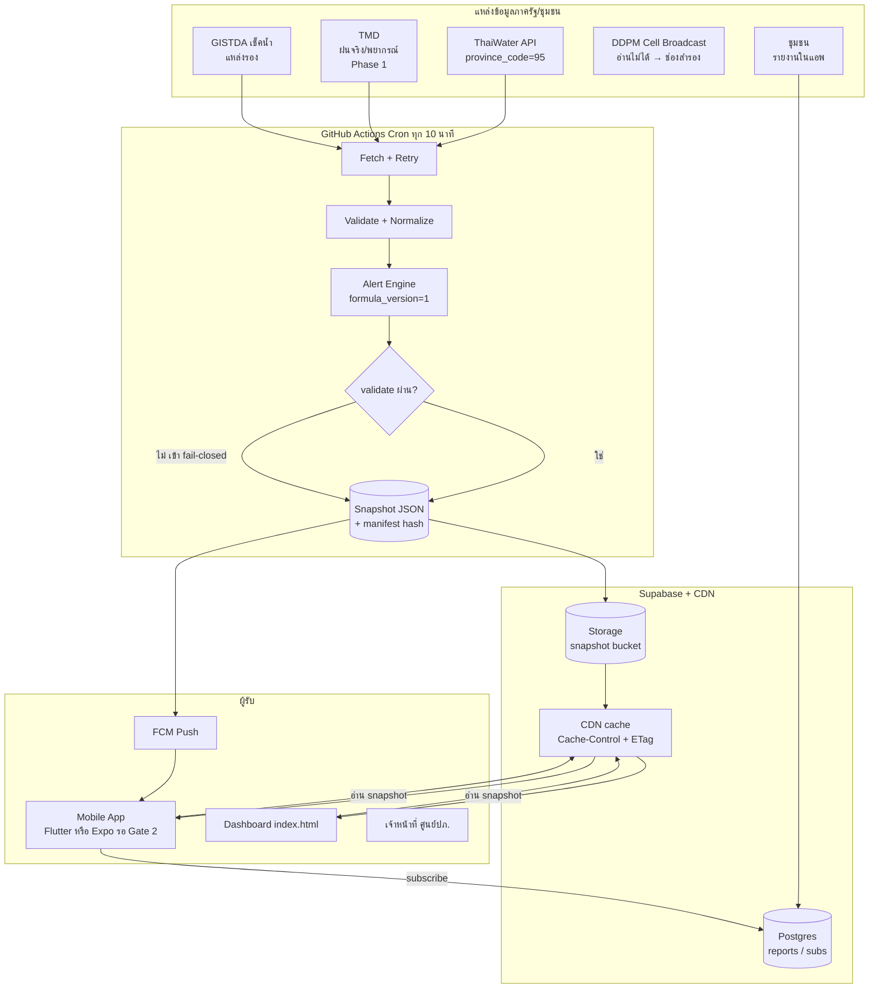
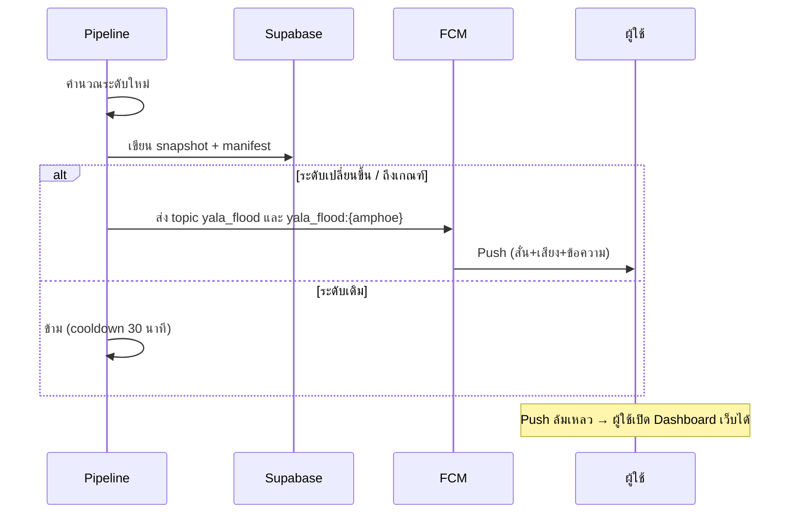

# 03 — สถาปัตยกรรมระบบเป้าหมาย (System Architecture)

> **เอกสารฐาน 03 ของโครงการ** · ฉบับนี้อธิบายสถาปัตยกรรมเป้าหมาย Phase 1–3
> **วันที่จัดทำ:** 23 พศ. 2568 · **สถานะ:** Draft — **รอ Gate 2** (ยืนยัน stack, schema, บริการภายนอก, กฎหมาย)
> **ข้อจำกัดสำคัญ:** Stack มือถือยังไม่ล็อก (Flutter เดิม vs Expo RN — DEC-004) ส่วน pipeline/Supabase/FCM เป็นข้อเสนอที่ต้องผ่าน Gate 2

---

## 1. ภาพรวมสถาปัตยกรรม



### 1.1 หลักการออกแบบ

| หลักการ | คำอธิบาย |
|---|---|
| Serverless/Managed first | GitHub Actions cron + Supabase + FCM — ไม่มีเซิร์ฟเวอร์ที่ต้องดูแล |
| Precompute ล่วงหน้า | pipeline คำนวณคะแนน 1 ครั้ง/รอบ ประชาชนอ่านผ่าน static snapshot + CDN |
| Offline-first | แอพเก็บ snapshot + manifest ไว้ในเครื่อง เปิดใช้ได้แม้ไม่มีสัญญาณ |
| Fail-closed | ข้อมูลเสีย → ไม่เขียนทับ snapshot ดี ๆ, ไม่ส่งแจ้งเตือนใหม่ |
| Privacy-by-design | PII เก็บในเครื่องให้มากที่สุด; ระบบกลางเก็บเฉพาะข้อมูลจำเป็น + RLS |
| Near-zero marginal cost | ไม่มี compute ต่อผู้ใช้; ไม่เปิด API เผชิญโดยตรง |

---

## 2. ส่วนประกอบหลัก

| ส่วน | เทคโนโลยี (เป้า) | หน้าที่ | สถานะ |
|---|---|---|---|
| Ingestion pipeline | GitHub Actions cron (ทุก 10 นาที) + Python/Node | ดึง ThaiWater/TMD → validate → normalize → คำนวณคะแนน → เขียน snapshot | Phase 1 |
| Validator/Normalizer | ภายใน pipeline | ตรวจ schema, ช่วงค่า, จังหวัด 95, ความล้าสมัย, outlier | Phase 1 |
| Alert Engine | ภายใน pipeline + ฝั่งแอพ (cross-check) | คำนวณ Alert Score ตามเอกสาร 04 | Phase 1 (methodology) |
| Storage/CDN | Supabase Storage (public bucket) + CDN | เก็บ snapshot/manifest ให้อ่านเร็ว ทั่วประเทศ | Phase 2 |
| Database | Supabase Postgres + RLS | reports, subscriptions, shelter registry, contact registry | Phase 2 |
| Push | Firebase Cloud Messaging (FCM) | ส่งการแจ้งเตือนตาม topic อำเภอ/จังหวัด | Phase 3 |
| Mobile app | Flutter (`mobile/app`) หรือ Expo RN+TS — **รอ Gate 2** | UI, แผนที่, SOS, แจ้งเตือนในเครื่อง, แคช | Phase 3 |
| Dashboard | Static HTML (`tools/dashboard/index.html`) | ภาพรวม 8 อำเภอ สำหรับเจ้าหน้าที่/ประชาชน | มีแล้ว |
| Web/legal | GitHub Pages (`web/`) | landing, privacy, terms, disclaimer | Phase 2 |
| Monitoring | GitHub Actions artifacts + log + health endpoint | แจ้งเตือนผู้ดูแลเมื่อ pipeline ล้มเหลว | Phase 2 |

---

## 3. วงรอบ Pipeline (cron ทุก 10 นาที)

```text
1. fetch      : GET ThaiWater province_code=95 (timeout 12s) + TMD (เมื่อผูกแล้ว)
2. retry      : ลองใหม่ 2 ครั้ง, backoff 900ms (เฉพาะข้อผิดพลาดชั่วคราว)
3. validate   : จำนวนสถานี, รหัสซ้ำ, จังหวัด=95, ประเภทข้อมูล, ค่าอยู่ในช่วง,
                ความล้าสมัย (เกิน 30 นาที = stale), outlier ของ sensor
4. normalize  : join station registry, เติม amphoe/tumbon/ตลิ่ง, คำนวณ diff_wl_bank
5. score      : Alert Score + override + hysteresis (เอกสาร 04)
6. write      : snapshot JSON (schema_version=1, formula_version=1) → คำนวณ SHA-256
7. manifest   : เขียน manifest (path, sha256, fetched_at, counts) — **เขียนทีหลังสุด**
8. publish    : upload แบบ atomic (tmp → rename) เข้า Supabase Storage
9. purge      : ลบ snapshot เก่าเกิน retention
10. notify     : ถ้าระดับเปลี่ยนขึ้น/ถึงเกณฑ์ → FCM (ระบุ snapshot_hash กันซ้ำ)
11. incident   : ถ้า validate ไม่ผ่าน → ไม่เขียนทับ snapshot ปัจจุบัน + log + แจ้งผู้ดูแล
```

### 3.1 การควบคุมต้นทุน (Free Tier)

| รายการ | ปริมาณ (ประมาณการ) | หมายเหตุ |
|---|---|---|
| ขนาด snapshot | ~24 KB/รอบ (ผลวัดจริง 23,975 bytes สำหรับ 14 สถานี) | บีบอัด gzip แล้วเล็กลง |
| จำนวนรอบ | 144 รอบ/วัน (ทุก 10 นาที) | ถ้า API อัปเดต ~30 นาที ลดเหลือ 72 รอบ/วันก็พอ |
| พื้นที่เก็บ (30 วัน) | ~104 MB | อยู่ใน Supabase Free tier ได้ (ตรวจสอบขีดจำกัดปัจจุบัน) |
| CDN egress | ~3.5 MB/วัน | ผู้ใช้เปิดแอพ = 1 รอบ/แคช (TTL 10 นาที) |
| Push | เฉพาะเมื่อระดับเปลี่ยน + cooldown 30 นาที | FCM ฟรี ปริมาณเล็ก |
| ไม่มี | compute ต่อผู้ใช้, webhook ต่อ request | งด API เผชิญโดยตรง |

> หมายเหตุด้าน quota: Supabase Free tier มีขีดจำกัด storage/egress ที่เปลี่ยนได้ — **ต้องตรวจสอบค่าปัจจุบัน**
> ก่อน Phase 2 และตั้ง retention/cache ให้พอดี

---

## 4. โครงสร้าง Snapshot และ Manifest

### 4.1 Snapshot JSON (schema_version=1)

```json
{
  "schema_version": 1,
  "formula_version": 1,
  "fetched_at": "2026-11-23T21:30:00+07:00",
  "source": "thaiwater",
  "station_count": 14,
  "meta": {
    "stale": false,
    "partial": false,
    "rain_available": false,
    "h_normal_confidence": "low",
    "generator": "yala-pipeline"
  },
  "stations": [
    {
      "code": "PAT002",
      "name_th": "เมืองยะลา",
      "amphoe_th": "เมืองยะลา",
      "tumbon_th": "ตาเซะ",
      "lat": 6.67525,
      "lon": 101.286354,
      "river": "เขื่อนปัตตานี",
      "waterlevel_msl": 12.98,
      "waterlevel_msl_previous": 12.98,
      "waterlevel_datetime": "2026-11-23 21:30",
      "left_bank": 13.85,
      "situation_level": 4,
      "storage_percent": 92.82,
      "diff_wl_bank": 0.85,
      "agency_shortname_th": "สสน.",
      "flash_flood": false,
      "signals": { "W": 0.78, "R": 0.0, "F": 0.0, "C": 0.0 },
      "score": 39.0,
      "level": 2,
      "flags": ["h_normal_low_confidence"]
    }
  ],
  "alerts": [
    {
      "amphoe_th": "เมืองยะลา",
      "level": 2,
      "score": 39.0,
      "message_th": "เฝ้าระวัง ระดับน้ำ 12.98 ม.รทก.",
      "updated_at": "2026-11-23T21:30:00+07:00"
    }
  ]
}
```

### 4.2 Manifest JSON (ตัวชี้ snapshot ปัจจุบัน)

```json
{
  "schema_version": 1,
  "formula_version": 1,
  "snapshot": "snapshots/2026/11/23/2130.json",
  "sha256": "sha256:<hash>",
  "fetched_at": "2026-11-23T21:30:00+07:00",
  "station_count": 14,
  "created_at": "2026-11-23T21:30:05+07:00",
  "generator": "yala-pipeline"
}
```

| กฎ | เหตุผล |
|---|---|
| manifest เป็น entry point เดียว | แอพไม่ต้องอ่านไฟล์ทุกรอบ |
| hash เทียบก่อนใช้งาน | กัน snapshot เสียหาย/แตะของ |
| `fetched_at` ใช้เวลาจาก API | กัน clock skew |
| `stale/partial` ต้องมีเสมอ | UI ต้องแสดงสถานะ |

---

## 5. ฝั่งมือถือ (Flutter หรือ Expo — รอ Gate 2)

### 5.1 ตัวเลือก stack (DEC-004)

| ตัวเลือก | ข้อดี | ข้อเสีย | ผลกระทบสถาปัตยกรรม |
|---|---|---|---|
| **A) คง Flutter** (`mobile/app`) | prototype พร้อม, analyze ผ่าน, tests 30/30, ใช้ API จริงได้ | ไม่ตรง Playbook 100% | ใช้ Codemagic/GitHub Actions build; แชร์ pipeline เดิม |
| **B) Expo RN+TS** | ตาม Playbook, EAS Build ผ่านตรง, ecosystem ครบ | เขียนใหม่ ~2 สัปดาห์ | เปลี่ยนแผน build/CI เท่านั้น |

> **ยังไม่ล็อก** — ทั้งสองตัวเลือกใช้ snapshot/CDN/FCM เดียวกัน จึงไม่กระทบ pipeline

### 5.2 การทำงานฝั่งแอพ

| ขั้น | พฤติกรรม |
|---|---|
| โหลด | อ่าน manifest → เทียบ hash → อ่าน snapshot (หรือใช้แคชถ้า hash ตรง) |
| แคช | เก็บ snapshot+manifest ใน `SharedPreferences`, TTL 30 นาที (`cacheTtl`) |
| ออฟไลน์ | ใช้ snapshot แคชล่าสุด + แสดงเวลา `fetched_at`; ไม่บังคับเน็ต |
| ตรวจแคช | เทียบ hash ของ manifest กับ snapshot; ไม่ตรง = ปฏิเสธ |
| รีเฟรช | ทุก 15 นาที (ตั้งค่าได้) หรือเมื่อแตะ refresh |
| SOS/report ออฟไลน์ | จองคิวไว้ในเครื่อง ส่งเมื่อมีเน็ต (Phase 1 backlog) |

---

## 6. Push Notification และช่องทางสำรอง



| กฎ | ค่า |
|---|---|
| Topic | `yala_flood` (ทั้งจังหวัด) + `yala_flood:{amphoe}` (รายอำเภอ) |
| เด้งจาก | ระดับเปลี่ยนขึ้นเท่านั้น (ไม่เด้งเมื่อคงที่) |
| Cooldown | 30 นาที (ยกเว้นระดับสูงขึ้น) |
| กันซ้ำ | ใส่ `snapshot_hash` ใน payload ตัดรอบซ้ำ |
| ช่องสำรอง | Dashboard เว็บ, SMS/Line OA (Phase 3+), Cell Broadcast DDPM (ภาครัฐ) |

---

## 7. ความเป็นส่วนตัว และ PDPA

| หลักการ | การปฏิบัติ |
|---|---|
| PII local-first | เบอร์โทร/พิกัด SOS เก็บในเครื่องก่อน; ระบบกลางเก็บเฉพาะข้อมูลจำเป็น |
| ขอยินยอมก่อน | มีหน้าจอ consent สำหรับตำแหน่ง/แจ้งเตือน ก่อนเก็บ |
| ไม่เก็บข้อมูลเกินจำเป็น | ไม่เก็บชื่อ-นามสกุล/บัตรประชาชน; ตำแหน่งแม่นยำไม่แสดงต่อสาธารณะ |
| RLS | anon key อ่าน snapshot/registry ได้เท่านั้น; เขียนได้เฉพาะ reports ที่ผ่าน validation |
| Service role | เฉพาะ pipeline/worker (server-side) ไม่อยู่ในแอพ |
| Retention | รายงานชุมชนลบหลัง 90 วัน; snapshot ลบตาม retention |
| สิทธิเจ้าของข้อมูล | มี "ลบข้อมูลของฉัน"; แจ้งเหตุละเมิดภายใน 72 ชม. |
| ไม่ขายข้อมูล | ห้ามเด็ดขาด; ไม่มีโฆษณา |

> หน้า privacy/terms อยู่ใน `web/` → GitHub Pages (Phase 2) ต้องผ่าน Gate 2 ก่อนเขียนข้อความจริง

---

## 8. แผน Fail-Closed และ Race Condition

### 8.1 Fail-Closed

| สถานการณ์ | พฤติกรรม |
|---|---|
| fetch ล้มเหลวทุกครั้ง | ไม่เขียน snapshot; คงไฟล์เดิม + เขียน incident log |
| validate ไม่ผ่าน | ไม่ publish; แจ้งผู้ดูแล; UI ใช้ snapshot เก่า + ป้าย stale |
| hash ไม่ตรง | แอพปฏิเสธ snapshot ใหม่ ใช้แคชเดิม |
| อ่าน snapshot ไม่ได้ | โหมดออฟไลน์ + เบอร์โทร |
| push ล้มเหลว | ไม่เขียน snapshot ผิด; ใช้ช่องสำรอง |

### 8.2 Race Condition

| ความเสี่ยง | วิธีป้องกัน |
|---|---|
| cron ซ้อน (overlap) | `concurrency` group ของ GitHub Actions หรือ lock ไฟล์; รอบใหม่ยกเลิกถ้ามีรอบก่อนยังไม่จบ |
| เขียนไฟล์ไม่สมบูรณ์ | atomic rename (เขียน `tmp` แล้ว rename); manifest เขียนทีหลังสุด |
| แอพอ่านระหว่างเขียน | อ่านผ่าน manifest + hash; ไม่อ่านไฟล์กลาง |
| push ซ้ำ | ตัดด้วย `snapshot_hash`; cooldown 30 นาที |
| นาฬิกาเครื่อง | ใช้ `fetched_at` จาก API; ไม่ใช้เวลาเซิร์ฟเวอร์ pipeline |
| partial data | ยอมรับเฉพาะ record ที่ validate ผ่าน + `partial=true` |

---

## 9. การขยายตัวและการบำรุงรักษา

| หัวข้อ | วิธี |
|---|---|
| CI/CD | GitHub Actions: test → build → deploy (Phase 2) |
| Monitoring | health endpoint + pipeline log + alert ผู้ดูแล |
| Registry ไม่ hardcode | station/shelter/contact registry อ่านจาก snapshot/DB โดยไม่ฝังในโค้ด |
| Dependency | อัปเดตสม่ำเสมอผ่าน Dependabot/Renovate |
| เอกสาร | ภาษาไทยทั้งหมด; baseline 01–04 + living files |

---

## 10. การ Map ไป Phase ต่าง ๆ

| Phase | งานสถาปัตยกรรม |
|---|---|
| 1 | สร้าง pipeline cron + validator + snapshot/manifest + station registry |
| 2 | GitHub repo private + workflow + Supabase Storage/DB + web/legal |
| 3 | ตัดสิน stack + platform folders + FCM + alert engine ฝั่งแอพ |
| 4 | QA audit + ทดสอบจริง (push/offline/SOS) |
| 5 | ขึ้นสโตร์ |
| 6 | ขยายภาคใต้ 3 จังหวัด (ผ่าน Gate 1) |

---

> **สรุป:** สถาปัตยกรรมเป้าหมายคือ **cron pipeline ดึง API → normalize/validate → snapshot + manifest hash →
> Supabase Storage CDN → FCM push** พร้อมแอพแบบ offline-first ที่ตรวจ hash ก่อนใช้
> ข้อตัดสินที่ต้องผ่าน Gate 2: เลือก Flutter หรือ Expo, ยืนยัน schema/snapshot, ยืนยัน Supabase/FCM ใช้ฟรีได้,
> และข้อความ privacy/terms
