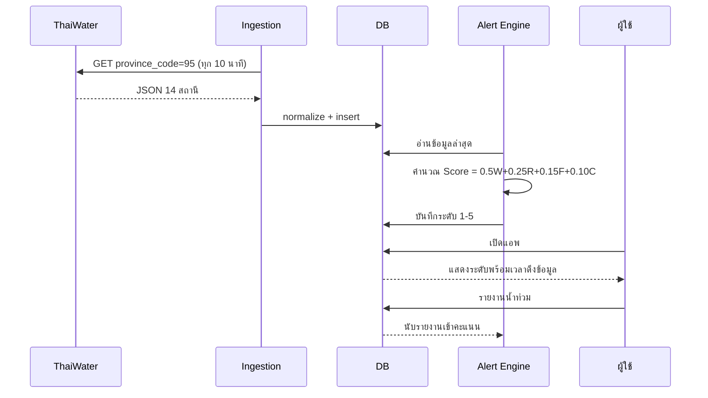

# PRD — แอพ "น้ำท่วมยะลา" (Yala Flood Watch)

> **Product Requirements Document (ฉบับเต็ม)**
> แอพพลิเคชันเฝ้าระวังและแจ้งเตือนน้ำท่วม จังหวัดยะลา ฟรีเพื่อประชาชน
> เวอร์ชันเอกสาร: 1.0 (Draft)
> วันที่: 23 พศ. 2568
> ผู้จัดทำ: นักพัฒนาคนเดียว + ทีม Agent (Yala Flood Watch)
> สถานะ: ร่างเพื่อตรวจสอบและพิจารณา

---

## สารบัญ

1. [บทนำและวิสัยทัศน์](#1-บทนำและวิสัยทัศน์)
2. [ปัญหาและขอบเขต](#2-ปัญหาและขอบเขต)
3. [ผู้ใช้เป้าหมาย (Personas)](#3-ผู้ใช้เป้าหมาย-personas)
4. [ขอบเขตฟีเจอร์: MVP vs ภายหลัง](#4-ขอบเขตฟีเจอร์-mvp-vs-ภายหลัง)
5. [ข้อกำหนดฟังก์ชัน (Functional Requirements)](#5-ข้อกำหนดฟังก์ชัน-functional-requirements)
6. [ข้อกำหนดไม่ใช่ฟังก์ชัน (NFR)](#6-ข้อกำหนดไม่ใช่ฟังก์ชัน-non-functional-requirements)
7. [สถาปัตยกรรมระบบและแผนผังข้อมูล](#7-สถาปัตยกรรมระบบและแผนผังข้อมูล)
8. [ตาราง API Contract](#8-ตาราง-api-contract)
9. [เกณฑ์การแจ้งเตือน](#9-เกณฑ์การแจ้งเตือน)
10. [แผนที่เส้นทางผู้ใช้ (User Journey)](#10-แผนที่เส้นทางผู้ใช้-user-journey)
11. [เกณฑ์ยอมรับ (Acceptance Criteria)](#11-เกณฑ์ยอมรับ-acceptance-criteria)
12. [KPI](#12-kpi)
13. [ความเสี่ยงและวิธีบริหาร](#13-ความเสี่ยงและวิธีบริหาร)
14. [โมเดลการมีชีวิต / นิติบุคคล](#14-โมเดลการมีชีวิต--นิติบุคคล)
15. [แผนเปิดตัวและการมีส่วนร่วมชุมชน](#15-แผนเปิดตัวและการมีส่วนร่วมชุมชน)
16. [ภาคผนวก](#16-ภาคผนวก)

---

## 1. บทนำและวิสัยทัศน์

### 1.1 คำอธิบายโครงการ

"น้ำท่วมยะลา" (Yala Flood Watch) คือแอพพลิเคชันมือถือและเว็บแอปพลิเคชัน (PWA) ที่รวบรวม
ข้อมูลระดับน้ำ ฝน และรายงานจากชุมชน มาคำนวณเป็น **คะแนนเตือนภัย (Alert Score)** และ
แจ้งเตือนประชาชนในจังหวัดยะลาอย่างทันท่วงที เพื่อให้ประชาชนมีเวลาเตรียมตัวและอพยพ
ก่อนน้ำท่วมถึงบ้าน

แอพนี้ **ฟรีทั้งหมด** ไม่มีโฆษณา ไม่มีการขายข้อมูล เปิดเผยโค้ดและข้อมูล
เป็น Open Data เพื่อความโปร่งใส

### 1.2 วิสัยทัศน์ (Vision)

> **"ทุกครัวเรือนในยะลา รู้ทันน้ำ รอดทันภัย"**
>
> เมื่อภัยน้ำท่วมมาถึง ประชาชนทุกคนสามารถเปิดแอพได้ รู้ทันทีว่าหมู่บ้านของตนอยู่ในระดับไหน
> ควรอยู่ ควรเฝ้าระวัง หรือควรอพยพ โดยไม่ต้องรอคนเดียวกับสื่อกระจายข่าว

### 1.3 พันธกิจ (Mission)

- ลดเวลาตอบสนองต่อภัยน้ำท่วมจาก "รู้ทีหลัง" สู่ "รู้ล่วงหน้า 2–4 ชั่วโมง"
- ทำให้ข้อมูลของหน่วยงานรัฐ (กรมทรัพยากรน้ำ, กรมอุตุฯ, กรมป้องกันฯ) เข้าถึงได้ง่าย
  เข้าใจง่าย ใช้งานได้จริงกับคนยะลา
- เพิ่มกลไก "ชุมชนรายงาน ↔ ระบบตรวจสอบ ↔ หน่วยงานตอบสนอง"
- สร้างระบบที่อยู่ได้ในระยะยาว ไม่ขึ้นกับแรงคนเดียว

### 1.4 คุณค่าหลัก (Core Values)

| คุณค่า | ความหมาย |
|---|---|
| ความปลอดภัยเป็นอันดับแรก | ข้อมูลที่ผิดพลาดยิ่งทำร้ายได้ ต้องมีกลไกตรวจสอบทุกชั้น |
| ความเรียบง่าย | ผู้ใช้ต้องใช้ได้ใน 10 วินาทีแรก ไม่ต้องอ่านคู่มือ |
| ความเท่าเทียม | ใช้ได้ทั้งคนชรา คนพิการ คนที่ไม่มีสัญญาณ ภาษาไทยและภาษาท้องถิ่น |
| ความโปร่งใส | เปิดเผยแหล่งข้อมูล เวลาดึงข้อมูล เหตุผลที่แจ้งเตือน |
| ความร่วมมือ | ไม่แข่งกับหน่วยงาน แต่เป็น "ช่องทางเสริม" ของ ศูนย์ปภ. และ DDPM |

### 1.5 ภัยล่าสุดที่เป็นบทแสดงความจำเป็น (19–27 พ.ย. 2568)

ระบบนี้ถูกออกแบบโดยอ้างอิงเหตุการณ์จริง ดังนี้:

| ตัวชี้วัด | ค่า |
|---|---|
| ช่วงเวลาฝนตกหนัก | 19–27 พศ. 2568 |
| อำเภอที่กระทบ | 8 อำเภอ |
| ตำบลที่กระทบ | 53 ตำบล |
| หมู่บ้านที่กระทบ | 289 หมู่บ้าน |
| ครัวเรือนที่กระทบ | 45,634 ครัวเรือน |
| ประชากรที่กระทบ | 122,350 คน |
| ผู้เสียชีวิต | 5 คน |
| ปริมาณน้ำเขื่อนบางลาง | 747.97 ล้าน ลบ.ม. (51.4%) |

เหตุการณ์นี้แสดงให้เห็น 3 บทเรียน:

1. **ข้อมูลกระจาย** — ประชาชนรู้จากสื่อหรือคนบอกกันปากต่อปาก
2. **น้ำท่วมฉับพลันเร็วเกินกว่าจะรอระดับน้ำ** — บางพื้นที่น้ำท่วมใน 2–4 ชม.
3. **ต้องการเวลาเตรียมตัว** — การอพยพครัวเรือน 122,350 คน ต้องรู้ล่วงหน้า

### 1.6 ขอบเขตภูมิศาสตร์

- **จังหวัด:** ยะลา (province_code=95) เท่านั้น
- **อำเภอเป้าหมาย:** 7–8 อำเภอ (รายละเอียดในข้อ 2.2)
- **แหล่งข้อมูลหลัก:** สถานีวัดระดับน้ำ 14 แห่ง

### 1.7 หลักการ "ฟรี โปร่งใส เปิดข้อมูล"

- แอพ **ฟรี** ตลอดชีพ ไม่มี paywall ไม่มีโฆษณา ไม่มี in-app purchase
- ข้อมูลดิบและ API เปิดเป็น **Open Data** (ตามเงื่อนไข PDPA)
- โค้ดเป็น Open Source เพื่อให้ภาคประชาชนตรวจสอบได้
- ไม่ขายข้อมูลส่วนบุคคลของผู้ใช้ ไม่ใช้ข้อมูลเพื่อผลกำไรโดยตรง

---

## 2. ปัญหาและขอบเขต

### 2.1 ปัญหา (Problem Statement)

**ปัญหาหลัก:** ประชาชนในจังหวัดยะลา **ขาดข้อมูลที่ทันท่วงที เข้าใจง่าย และเชื่อถือได้**
เมื่อเกิดฝนตกหนักและน้ำท่วม ทำให้ตัดสินใจอพยพไม่ทัน เสียทรัพย์สินและเสียชีวิต

ปัญหาย่อย:

| ปัญหาย่อย | รายละเอียด |
|---|---|
| P1. ข้อมูลกระจาย | ต้องไล่ดู 4–5 แหล่ง (กรมทรัพยากรน้ำ, กรมอุตุฯ, เช็คน้ำ, ศูนย์ปภ., เพจชุมชน) |
| P2. ภาษาเทคนิค | ค่าระดับน้ำ "13.0 ม.รทก." ยากที่ประชาชนจะตีความว่า "ท่วมหรือยัง" |
| P3. น้ำท่วมฉับพลัน | ระดับน้ำสถานียังปกติ แต่น้ำในตัวบ้านทยอยท่วมใน 2–4 ชม. |
| P4. ช่องแจ้งเตือนไม่ถึง | Cell Broadcast เข้าถึงได้จำกัด เสียงไม่ได้ยิน ภาษาไม่ตรง |
| P5. ความเหลื่อมล้ำ | คนไม่มีสมาร์ทโฟน คนพิการ คนชรา ขาดช่องทาง |
| P6. ไม่มีหน่วยงานกลาง | แต่ละหน่วยงานมีระบบของตน ไม่มีผู้ "รวมและเชื่อมโยง" |

### 2.2 ขอบเขตที่เข้ม (In Scope) — 8 อำเภอเป้าหมาย

ระบบนี้มุ่งเฉพาะ **จังหวัดยะลา** ใน 8 อำเภอที่มีความเสี่ยงสูง:

| อำเภอ | รูปแบบภัยหลัก | หมู่บ้านเสี่ยง 10 ปี |
|---|---|---:|
| เมืองยะลา | น้ำท่วมขังริมแม่น้ำปัตตานี | 84 |
| รามัน | น้ำท่วมขังริมแม่น้ำปัตตานี | 85 |
| ยะหา | น้ำท่วมขังริมแม่น้ำปัตตานี | 44 |
| บันนังสตา | น้ำท่วมฉับพลัน | 38 |
| กรงปินัง | น้ำท่วมฉับพลัน | 22 |
| เบตง | น้ำท่วมฉับพลัน | 40 |
| ธารโต | น้ำท่วมฉับพลัน | 9 |
| กาบัง | น้ำท่วมฉับพลัน | (ผนวกในภาคผนวก) |
| **รวม 7 อำเภอ (ข้อมูลหมู่บ้าน)** | | **322 หมู่บ้าน** |

> หมายเหตุ: ข้อมูลหมู่บ้านเสี่ยง 10 ปีมีให้ครบ 7 อำเภอ (85+84+44+40+38+22+9 = 322) ส่วนกาบัง
> ได้รับผลกระทบในเหตุการณ์ 19–27 พ.ย. 2568 แต่ยังไม่มีตัวเลขหมู่บ้านเสี่ยงในชุดข้อมูลนี้

### 2.3 ขอบเขตที่ตัดออก (Out of Scope)

- ❌ จังหวัดอื่นนอกเหนือยะลา (ปัตตานี นราธิวาส สตูล ภาคอื่น) ใน MVP
- ❌ การทำนายระดับน้ำแบบ hydraulic model เชิงลึก
- ❌ ระบบควบคุมเขื่อน/ระบายน้ำโดยตรง
- ❌ ระบบสั่งการดิจิทัลของหน่วยงาน (เป็นฝีมือของหน่วยงาน)
- ❌ การรับซื้อข้อมูลจากบริษัทเอกชนที่เกี่ยวข้องกับการสาธารณภัย
- ❌ แอพ iOS native (MVP เป็น PWA ใช้ได้ทั้ง iOS/Android)

### 2.4 ข้อจำกัดและสมมติฐาน (Constraints & Assumptions)

| ประเภท | รายละเอียด |
|---|---|
| ข้อจำกัด | ต้องพึ่งข้อมูลภาครัฐเป็นหลัก ไม่สามารถเปลี่ยนเกณฑ์ของหน่วยงานได้ |
| ข้อจำกัด | บุคลากรเพียง 1 คน + Agent ต้องใช้เครื่องมืออัตโนมัติสูง |
| สมมติฐาน | ThaiWater API พร้อมใช้และมี SLA เพียงพอ |
| สมมติฐาน | ประชาชนมีสมาร์ทโฟนหรือเครื่องใช้ข้อมูลอย่างน้อย |
| สมมติฐาน | หน่วยงานเปิดรับข้อมูลรายงานจากชุมชนเข้าสู่ระบบของตน |

### 2.5 สองรูปแบบภัยที่ต้องออกแบบรองรับ

| รูปแบบ | พื้นที่ | ลักษณะ | ผลกระทบต่อแอพ |
|---|---|---|---|
| **น้ำท่วมขังริมแม่น้ำปัตตานี** | เมืองยะลา, รามัน, ยะหา | น้ำขึ้นช้า 1–3 วัน ลดระดับช้า ท่วมวงกว้าง | ใช้ระดับน้ำ + ปริมาณน้ำเขื่อนบางลางเป็นตัวทำนายหลัก |
| **น้ำท่วมฉับพลัน (Flash Flood)** | บันนังสตา, กรงปินัง, เบตง, กาบัง, ธารโต | น้ำท่วมใน 2–4 ชม. จากฝนภูเขา | ต้องเร่งน้ำหนัก "ฝนจริง" และ "รายงานชุมชน" มากขึ้น |

> การออกแบบต้อง **ไม่ใช้ตัวเดียวกันทั้งสองรูปแบบ** — มี override เฉพาะเขต Flash Flood (ดูข้อ 9)

---

## 3. ผู้ใช้เป้าหมาย (Personas)

### 3.1 ตารางสรุป Persona

| # | Persona | บทบาท | ความต้องการหลัก | อุปสรรค |
|---|---|---|---|---|
| P1 | ชาวสวน/ชาวนาริมแม่น้ำปัตตานี | เมือง/รามัน/ยะหา | รู้ว่าระดับน้ำจะสูงขึ้นอีกไหม | ค่าระดับน้ำเข้าใจยาก |
| P2 | ชาวบ้านเขตน้ำท่วมฉับพลัน | บันนังสตา/กาบัง | รู้ทันทีว่าฝนในภูเขาจะน้ำท่วมหรือไม่ | น้ำท่วมเร็ว ไม่มีเวลา |
| P3 | เจ้าหน้าที่ อปท./เทศบาล/ศูนย์ปภ. | ทั้ง 8 อำเภอ | ข้อมูลรวม + เวลา + รายงานชุมชน | ระบบกระจาย |
| P4 | ผู้สูงอายุ/ผู้พิการ | ทั่วไป | เสียงพูด ฟอนต์ใหญ่ แจ้งเตือนชัด | เทคโนโลยีสูง |
| P5 | นักเรียน/นักศึกษา/ประชาชนทั่วไป | ทั่วไป | ข่าวสารรวดเร็ว แชร์ต่อได้ | ข้อมูลเยอะเกิน |

### 3.2 รายละเอียด Persona

#### P1 — "แม่สมหมีย์" ชาวสวนยาง/มังคุด ร.รามัน

- อายุ 45 ปี อยู่ตำบลตะโล๊ะหะลอ อ.รามัน
- ปกติดูข้อมูลจากเพจชุมชนและวิทยุชุมชน
- กังวลเรื่องน้ำท่วมขัง เพราะปีที่แล้วสวนเสียหาย
- ต้องการรู้ "ระดับน้ำตอนนี้อยู่เหนือตลิ่งหรือยัง" และ "จะขึ้นอีกกี่วัน"
- ถ้าแอพบอก "อันตราย" จะพาครอบครัวไปพักที่บ้านพี่ในเมือง

#### P2 — "ยามี" ชาวบ้าน บันนังสตา

- อายุ 32 ปี ค้าส่ง/ขับรถทัวร์
- อยู่ในเขตน้ำท่วมฉับพลัน
- ครั้งก่อนน้ำท่วมภายใน 3 ชม. รถเสีย
- ต้องการ **การแจ้งเตือนที่ดังและชัดเจน** พร้อม "ทางหนีภัย/จุดพักพิง"
- ใช้โทรศัพท์น้อย ต้องการข้อความสั้น + เสียง

#### P3 — "สำราญ" เจ้าหน้าที่ อำเภอ/เทศบาล

- อายุ 38 ปี ผู้ประสานงานกู้ภัยใน อ.เมือง
- ต้องการภาพรวมทั้งอำเภอ ว่าตำบลไหนกำลังฝนตกหนัง ระดับน้ำเท่าไหร่
- ต้องการรายงานจากชุมชนเพื่อส่งต่อให้ ศูนย์ปภ.
- ใช้คอมพิวเตอร์ + มือถือ

#### P4 — "ป้าเล็ก" ผู้สูงอายุ

- อายุ 68 ปี อยู่เมืองยะลา ตาสั้น ไม่อ่านเล็ก
- ต้องการปุ่มใหญ่ ฟอนต์ใหญ่ เสียงพูด "น้ำท่วมแล้ว ควรอพยพ"
- อยู่กับลูกหลานในต่างเมือง ถ้ามีเหตุเดียวเดียวก็ส่งต่อให้

#### P5 — "ไข่" นักศึกษามหาวิทยาลัย

- อายุ 20 ปี ใช้โซเชียลหนัก
- ต้องการข้อมูลที่ **แชร์ต่อได้** (ภาพกราฟิก/ลิงก์)
- ช่วยผู้ปกครองตัดสินใจเมื่อเห็นข้อมูลชัดเจน

### 3.3 ความคาดหวังขั้นต่ำของทุก Persona

- เปิดแอพแล้ว **10 วินาทีแรก** เห็นสถานการณ์หมู่บ้านตัวเอง
- รู้ว่าข้อมูลนี้ **ดึงเมื่อกี่โมง**
- มีปุ่ม **"โทรหน่วยงาน"** แบบกดแล้วต่อได้ทันที
- ไม่ต้องสมัครสมาชิกก็ดูได้ (ลดอุปสรรค)

---

## 4. ขอบเขตฟีเจอร์: MVP vs ภายหลัง

### 4.1 MVP (Minimum Viable Product) — 12 สัปดาห์แรก

MVP คือระบบที่ **แจ้งเตือนได้จริง ถึงมือประชาชนได้จริง** ใน 8 อำเภอเป้าหมาย

| กลุ่ม | ฟีเจอร์ MVP |
|---|---|
| ข้อมูล | ดึงระดับน้ำ 14 สถานี (ThaiWater), ฝน TMD, เช็คน้ำ (GISTDA) |
| คำนวณ | Alert Score ตามสูตร 0.5/0.25/0.15/0.10 ระดับ 1–5 |
| แสดงผล | หน้ารวม 8 อำเภอ, หน้าอำเภอ, หน้าหมู่บ้าน |
| แจ้งเตือน | Push + Web Notification + หน้าจอ Dashboard ประจำจังหวัด |
| รายงาน | ฟอร์มรายงานชุมชน (น้ำท่วม/เส้นทาง/ความเสียหาย) |
| ของช่วย | เบอร์โทรหน่วยงาน, แผนที่จุดพักพิงเบื้องต้น |
| ระบบ | PWA, ใช้งานออฟไลน์บางส่วน, Dashboard (index.html) |

### 4.2 ฟีเจอร์ภายหลัง (Post-MVP)

| ระดับ | ฟีเจอร์ | เหตุผล |
|---|---|---|
| Phase 2 | กราฟระดับน้ำย้อนหลัง 24 ชม. | ประชาชนเห็น "น้ำขึ้นหรือลด" |
| Phase 2 | ระบบรายงานอัตโนมัติเข้า ศูนย์ปภ. | ลดภาระเจ้าหน้าที่ |
| Phase 3 | การแจ้งเตือนผ่าน SMS/Line OA สำหรับคนไม่มีสมาร์ทโฟน | ความเท่าเทียม |
| Phase 3 | ภาษามลายูปัตตานี (ยาวี) + เสียง | ความคงเท้าถิ่น |
| Phase 3 | โมเดลคาดการณ์ 24 ชม. ด้วย ML | เพิ่มเวลาเตือน |
| Phase 4 | ระบบเส้นทางอพยพและนำร่อง | ใช้ร่วมกับเทศบาล |
| Phase 4 | รองรับ 3 จังหวัดชายแดน | ขยายผล |

### 4.3 เกณฑ์การตัดสินใจฟีเจอร์ (Prioritization)

ใช้หลักการ: **"ฟีเจอร์ที่ช่วยให้รอดชีวิตได้ทันที ผ่านก่อน"**

- ถ้าฟีเจอร์ช่วย **ตัดสินใจอพยพ** ได้ → MVP
- ถ้าฟีเจอร์ทำให้ **เข้าใจง่ายขึ้น** → MVP
- ถ้าฟีเจอร์ทำให้ **ระบบยั่งยืน** (ไม่พัง) → MVP
- ถ้าฟีเจอร์เพิ่ม **ความสะดวก** → ภายหลัง

### 4.4 แผนงาน 12 สัปดาห์ (Roadmap)

| สัปดาห์ | งานหลัก | ผลลัพธ์ (Deliverable) | หน่วยงานที่เกี่ยวข้อง |
|---|---|---|---|
| 1 | รวบรวมข้อมูลสถานี 14 แห่ง + ตรวจความถูกต้อง | ฐานข้อมูลสถานีที่ยืนยันแล้ว | กรมทรัพยากรน้ำ |
| 2 | ต่อ ThaiWater API และทดสอบการดึงข้อมูล | ระบบดึงข้อมูลอัตโนมัติ | กรมทรัพยากรน้ำ |
| 3 | ออกแบบโมเดล Alert Score และเกณฑ์ | เอกสารเกณฑ์ที่หน่วยงานรับรองได้ | กรมทรัพยากรน้ำ, DDPM |
| 4 | ต่อ TMD (ฝนจริง/พยากรณ์) และ GISTDA | ข้อมูลฝนครบในระบบ | กรมอุตุฯ, GISTDA |
| 5 | สร้างหน้า Dashboard 8 อำเภอ (index.html) | Dashboard ใช้ได้จริง | ทีมพัฒนา |
| 6 | สร้างฟอร์มรายงานชุมชน | ผู้ใช้รายงานได้ | มูลนิธิอาสาเพื่อนพึ่ง |
| 7 | Push Notification + cooldown/dedup | แจ้งเตือนได้จริง | ทีมพัฒนา |
| 8 | ทดสอบกับผู้ใช้จริง (8 อำเภอ) | รายงานผล usability | ศูนย์ปภ.ยะลา |
| 9 | ปรับปรุงตาม feedback + Accessibility | ผ่าน WCAG 2.1 AA | ทีมพัฒนา |
| 10 | ผสานกับ Cell Broadcast DDPM (ทางเลือก) | ช่องแจ้งเตือนสำรอง | DDPM |
| 11 | อบรมเจ้าหน้าที่ อปท./เทศบาล | เจ้าหน้าที่ใช้ได้ | เทศบาลนครยะลา |
| 12 | Soft Launch ทั้ง 8 อำเภอ + วัดผล | ระบบเปิดให้ประชาชนใช้ | ทุกภาคี |

### 4.5 การจัดลำดับแบบ MoSCoW

- **Must have:** ดึงข้อมูล, คำนวณคะแนน, แสดงระดับ 8 อำเภอ, แจ้งเตือน, เบอร์โทร
- **Should have:** รายงานชุมชน, กราฟ 24 ชม., จุดพักพิง
- **Could have:** ภาษามลายู, โหมดสำหรับคนพิการขั้นสูง
- **Won't have (ตอนนี้):** โมเดล hydraulic, ระบบควบคุมเขื่อน

---

## 5. ข้อกำหนดฟังก์ชัน (Functional Requirements)

> ใช้ศัพท์มาตรฐาน RFC-2119: **MUST** (ต้อง), **SHOULD** (ควร), **MAY** (อาจ)

### 5.1 การรับข้อมูล (Ingestion)

| ID | ความต้องการ | ระดับ |
|---|---|---|
| FR-001 | ระบบ **MUST** ดึงข้อมูลระดับน้ำจาก ThaiWater API ทุก 10 นาที | MUST |
| FR-002 | ระบบ **MUST** ดึงข้อมูลฝนจริงและพยากรณ์ฝนจาก TMD ทุก 30 นาที | MUST |
| FR-003 | ระบบ **SHOULD** ดึงข้อมูลปริมาณน้ำเขื่อนบางลางจากกรมทรัพยากรน้ำ | MUST |
| FR-004 | ระบบ **MUST** แสดงเวลาที่ข้อมูลถูกดึงล่าสุดให้ผู้ใช้เห็นทุกหน้า | MUST |
| FR-005 | ระบบ **MUST** รองรับกรณีแหล่งข้อมูลล่ม (timeout) โดยแสดงข้อมูลล่าสุด + ป้าย "ข้อมูลล้าสมัย" | MUST |
| FR-006 | ระบบ **SHOULD** ดึงข้อมูล "เช็คน้ำ" ของ GISTDA เป็นแหล่งรอง | SHOULD |

### 5.2 การคำนวณคะแนน (Alert Engine)

| ID | ความต้องการ | ระดับ |
|---|---|---|
| FR-101 | ระบบ **MUST** คำนวณ Alert Score ตามสูตรที่กำหนดในข้อ 9 | MUST |
| FR-102 | ระบบ **MUST** จัดระดับ 1–5 ตามเกณฑ์ในข้อ 9 | MUST |
| FR-103 | ระบบ **MUST** ใช้ override เร่งระดับสำหรับเขตน้ำท่วมฉับพลัน | MUST |
| FR-104 | ระบบ **SHOULD** มี hysteresis (ล็อกระดับสูง 2 ชม.) เพื่อกันสัญญาณกระชาก | SHOULD |
| FR-105 | ระบบ **SHOULD** บันทึกประวัติคะแนนย้อนหลังอย่างน้อย 30 วัน | SHOULD |
| FR-106 | ระบบ **MAY** คำนวณคะแนนรายหมู่บ้านจากข้อมูลสถานีที่ใกล้ที่สุด | MAY |

### 5.3 การแสดงผล (Presentation)

| ID | ความต้องการ | ระดับ |
|---|---|---|
| FR-201 | ระบบ **MUST** แสดงระดับเตือน 5 ระดับพร้อมสี เขียว/เหลือง/ส้ม/แดง/แดงเข้ม | MUST |
| FR-202 | ระบบ **MUST** แสดงรายชื่ออำเภอ 8 อำเภอพร้อมระดับของแต่ละอำเภอ | MUST |
| FR-203 | ระบบ **MUST** แสดงระดับน้ำ (ม.รทก.) เทียบตลิ่ง และ % ความจุอ่างเก็บ | MUST |
| FR-204 | ระบบ **SHOULD** แสดงแผนที่ตำแหน่งสถานี 14 แห่ง | SHOULD |
| FR-205 | ระบบ **MUST** แสดงข้อความ "ควรทำอะไร" ตามระดับ (อยู่/เฝ้าระวัง/เตรียมอพยพ/อพยพ) | MUST |
| FR-206 | ระบบ **SHOULD** แสดงกราฟระดับน้ำย้อนหลัง 24 ชม. | SHOULD |
| FR-207 | ระบบ **MUST** มีหน้า "วิธีใช้ข้อมูลตัดสินใจ" แบบเข้าใจง่าย | MUST |

### 5.4 การแจ้งเตือน (Notification)

| ID | ความต้องการ | ระดับ |
|---|---|---|
| FR-301 | ระบบ **MUST** ส่ง Push Notification เมื่อระดับเตือนเปลี่ยนขึ้น | MUST |
| FR-302 | ระบบ **MUST** ไม่ส่งซ้ำภายในช่วง cooldown 30 นาที (ยกเว้นระดับสูงขึ้น) | MUST |
| FR-303 | ระบบ **SHOULD** ส่งเสียง/สั่นแยกต่างหากตามระดับ | SHOULD |
| FR-304 | ระบบ **MAY** ส่ง SMS สำหรับระดับ 5 ในพื้นที่ยังไม่มีสัญญาณอินเทอร์เน็ต | MAY |
| FR-305 | ระบบ **MUST** ให้ผู้ใช้เลือกอำเภอ/หมู่บ้านที่ต้องการรับแจ้งเตือน | MUST |
| FR-306 | ระบบ **MUST** แสดงปุ่มโทรหน่วยงานได้จากหน้าแจ้งเตือน | MUST |

### 5.5 รายงานจากชุมชน (Community Reporting)

| ID | ความต้องการ | ระดับ |
|---|---|---|
| FR-401 | ระบบ **MUST** ให้ผู้ใช้รายงาน "น้ำท่วม/น้ำขึ้น/เส้นทาง/ความเสียหาย" ได้ | MUST |
| FR-402 | ระบบ **MUST** ขอตำแหน่ง (geolocation) และ **MUST** ขอความยินยอมก่อน | MUST |
| FR-403 | ระบบ **SHOULD** รองรับรูปถ่ายและข้อความสั้น | SHOULD |
| FR-404 | ระบบ **SHOULD** มีระบบคะแนนความน่าเชื่อถือของรายงาน | SHOULD |
| FR-405 | ระบบ **MUST** ไม่แสดงตำแหน่งแม่นยำของผู้รายงานต่อสาธารณะ | MUST |
| FR-406 | ระบบ **SHOULD** ส่งรายงานที่ผ่านการตรวจสอบไปยัง ศูนย์ปภ.ยะลา | SHOULD |

### 5.6 การเข้าถึงและรองรับอุปกรณ์

| ID | ความต้องการ | ระดับ |
|---|---|---|
| FR-501 | ระบบ **MUST** เป็น PWA ใช้ได้บน Android/iOS ผ่านเบราว์เซอร์ | MUST |
| FR-502 | ระบบ **MUST** ทำงานออฟไลน์บางส่วน (แคชข้อมูลล่าสุด) | SHOULD |
| FR-503 | ระบบ **MUST** รองรับหน้าจอเล็ก (360px) และฟอนต์ใหญ่ | MUST |
| FR-504 | ระบบ **SHOULD** มีโหมดความเข้ม/ความสว่างสำหรับใช้กลางคืน | SHOULD |

---

## 6. ข้อกำหนดไม่ใช่ฟังก์ชัน (Non-Functional Requirements)

### 6.1 ประสิทธิภาพ (Performance)

| ID | ตัวชี้วัด | เป้าหมาย | วิธีวัด |
|---|---|---|---|
| NFR-P01 | เวลาตอบสนอง API เป็นเส้น p95 | ≤ 500 ms | APM |
| NFR-P02 | เวลาโหลด Dashboard บน 3G | ≤ 3 s | Lighthouse |
| NFR-P03 | เวลาโหลดหน้าแรกบน 4G | ≤ 1.5 s | Lighthouse |
| NFR-P04 | จำนวนผู้ใช้พร้อมกัน | รองรับ 10,000 concurrent | Load test |
| NFR-P05 | การประมวลผล Alert Score | ≤ 1 s ต่อ รอบ | มิเตอร์ภายใน |
| NFR-P06 | หน้าจอ Dashboard อัปเดตอัตโนมัติ | ทุก 60 s | ตรวจสอบอัตโนมัติ |

### 6.2 ความพร้อมใช้งาน (Availability)

| ID | ตัวชี้วัด | เป้าหมาย |
|---|---|---|
| NFR-A01 | ความพร้อมใช้งานต่อปี (ทั่วไป) | ≥ 99.5% |
| NFR-A02 | ความพร้อมใช้งานในฤดูฝน (พ.ย.–ม.ค.) | ≥ 99.9% |
| NFR-A03 | เวลาหยุดซ่อมบำรุง (RTO) | ≤ 15 นาที |
| NFR-A04 | ข้อมูลสูญหาย (RPO) | ≤ 10 นาที |
| NFR-A05 | ระบบแจ้งเตือน **MUST** มีช่องทางสำรอง เมื่อ Push ล้มเหลว | 1 ช่องทาง |
| NFR-A06 | มีการ restore ข้อมูลจาก backup ได้ | ทุก 24 ชม. |

> **หมายเหตุสำคัญ:** ในช่วงเหตุการณ์จริง ระบบต้อง **ไม่พึ่งช่องทางเดียว** — ต้องมี
> หน้าเว็บ, Dashboard ประจำจังหวัด และ Line/SMS สำรอง

### 6.3 ความเป็นส่วนตัว (PDPA Compliance)

| ID | ข้อกำหนด | รายละเอียด |
|---|---|---|
| NFR-PD01 | ขอความยินยอมก่อนเก็บข้อมูล | มีหน้าจอ consent ชัดเจน |
| NFR-PD02 | เก็บเฉพาะข้อมูลจำเป็น | ไม่เก็บชื่อ-นามสกุล ไม่เก็บบัตรประชาชน |
| NFR-PD03 | ตำแหน่งเป็นข้อมูลที่มีความละเอียดสูง | ขอยินยอมแยก ไม่บังคับ |
| NFR-PD04 | ลบข้อมูลตามระยะเวลา | ข้อมูลรายงานลบหลัง 90 วัน ยกเว้นที่หน่วยงานต้องการ |
| NFR-PD05 | สิทธิของเจ้าของข้อมูล | มีปุ่ม "ลบข้อมูลของฉัน" |
| NFR-PD06 | การแจ้งเหตุการณ์ละเมิด | มีขั้นตอนแจ้งภายใน 72 ชม. |
| NFR-PD07 | ไม่ขาย/เปิดเผยข้อมูลเพื่อการค้า | ห้ามเด็ดขาด |
| NFR-PD08 | การเข้าถึงข้อมูล | มี audit log ของผู้เข้าถึงข้อมูล |

### 6.4 การเข้าถึง (Accessibility)

| ID | ข้อกำหนด |
|---|---|
| NFR-AC01 | รองรับ **WCAG 2.1 AA** |
| NFR-AC02 | รองรับ Screen Reader (VoiceOver/TalkBack) |
| NFR-AC03 | ฟอนต์ไทยอ่านง่าย ขนาดขั้นต่ำ 16px ปุ่มใหญ่ |
| NFR-AC04 | ความคมชัดของสี ≥ 4.5:1 |
| NFR-AC05 | รองรับการซูม 200% โดยไม่ล้นหน้าจอ |
| NFR-AC06 | แจ้งเตือนทุกระดับมี **ทั้งสี ข้อความ และสัญญาณเสียง** (ไม่พึ่งสีเดียว) |
| NFR-AC07 | ใช้ภาษาที่เข้าใจง่าย ไม่ใช้คำเทคนิคเกินจำเป็น |
| NFR-AC08 | มีโหมดภาษามลายูปัตตานีใน Phase 3 |

### 6.5 ความปลอดภัย (Security)

| ID | ข้อกำหนด |
|---|---|
| NFR-S01 | ใช้ HTTPS ทั้งหมด |
| NFR-S02 | ตรวจสอบอินพุตทุกช่อง (XSS/SQLi) |
| NFR-S03 | จำกัดอัตราการรายงาน (rate limit) กันสแปม |
| NFR-S04 | ไม่เก็บรหัสผ่านในโค้ด |
| NFR-S05 | มีการปรับปรุง dependency อย่างสม่ำเสมอ |

### 6.6 การขยายตัวและการบำรุงรักษา

| ID | ข้อกำหนด |
|---|---|
| NFR-SC01 | โค้ดเป็น Open Source ตาม license ที่เหมาะสม |
| NFR-SC02 | มี CI/CD สำหรับ deploy อัตโนมัติ |
| NFR-SC03 | มีระบบ monitoring + แจ้งเตือนผู้ดูแล |
| NFR-SC04 | เอกสารประกอบการใช้งานทั้งภาษาไทย |

---

## 7. สถาปัตยกรรมระบบและแผนผังข้อมูล

### 7.1 ภาพรวมสถาปัตยกรรม

```mermaid
flowchart TD
    subgraph แหล่งข้อมูล
        A1[ThaiWater API\nprovince_code=95]
        A2[กรมอุตุฯ TMD\nฝนจริง/พยากรณ์]
        A3[GISTDA\nแอป เช็คน้ำ]
        A4[DDPM\nCell Broadcast]
        A5[ชุมชน\nรายงานผ่านแอพ]
    end

    subgraph ชั้นรับข้อมูล
        B1[Ingestion Worker\ncron ทุก 10 นาที]
        B2[Validator + Normalizer]
    end

    subgraph ชั้นประมวลผล
        C1[(ข้อมูลสถานี 14)]
        C2[(ข้อมูลฝน)]
        C3[Alert Engine\nScore 0.5/0.25/0.15/0.10]
        C4[(Alert State\nระดับ 1-5)]
    end

    subgraph ชั้นบริการ
        D1[API Server]
        D2[Push Service]
        D3[Dashboard Static]
    end

    subgraph ผู้รับ
        E1[ผู้ใช้ PWA]
        E2[เจ้าหน้าที่ ศูนย์ปภ.]
        E3[ประชาชนทั่วไป]
    end

    A1 --> B1
    A2 --> B1
    A3 --> B1
    A4 --> B1
    A5 --> D1
    B1 --> B2 --> C1 & C2
    C1 & C2 --> C3 --> C4
    C4 --> D1
    C4 --> D2
    D1 --> E1
    D1 --> E2
    D2 --> E3
    D3 --> E3
```

### 7.2 ส่วนประกอบหลัก

| ส่วน | เทคโนโลยีที่เสนอ | หน้าที่ |
|---|---|---|
| Frontend | PWA (HTML/JS/CSS) | หน้าจอผู้ใช้ ใช้ได้ทุกอุปกรณ์ |
| Dashboard | Static HTML (index.html) | หน้ารวม 8 อำเภอ สำหรับเจ้าหน้าที่/ประชาชน |
| API Server | เซิร์ฟเวอร์บางใบ (Node/Python) | คำนวณ/ให้บริการข้อมูล |
| Ingestion Worker | Cron + script | ดึงข้อมูลจากภาครัฐ |
| Database | SQLite/PostgreSQL | เก็บสถานี, คะแนน, รายงาน |
| Cache | หน่วยความจำ/Redis เล็ก | ลดการเรียกซ้ำ |
| Push | Web Push / Line | แจ้งเตือน |

### 7.3 แผนผังข้อมูล (Data Flow)



### 7.4 โครงสร้างข้อมูลหลัก (Schema โดยย่อ)

```
station {
  id          : string      // รหัสสถานี (เช่น PAT002)
  name        : string      // เมืองยะลา
  river       : string      // แม่น้ำปัตตานี
  amphoe      : string      // เมืองยะลา
  tumbon      : string
  lat, lon    : number
  bank_level  : number      // ระดับตลิ่ง
  source      : string      // สสน. / กฟผ.
}

waterlevel {
  station_id  : string
  level       : number      // ม.รทก.
  measured_at : datetime
  situation   : 1..4        // ระดับของกรมทรัพยากรน้ำ
}

rain {
  amphoe      : string
  rain_1h     : number      // mm
  forecast_24h: number      // mm
  source      : TMD
  measured_at : datetime
}

report {
  id          : uuid
  type        : flood|road|damage
  lat, lon    : number      // ปิดบังต่อสาธารณะ
  created_at  : datetime
  trust_score : 0..5
  expires_at  : datetime    // ลบหลัง 90 วัน
}

alert_state {
  amphoe      : string
  level       : 1..5
  score       : 0..100
  updated_at  : datetime
  cooldown_until : datetime
}
```

---

## 8. ตาราง API Contract

### 8.1 API ภายนอกที่รับข้อมูล (External Sources)

| แหล่ง | Endpoint / วิธี | Fields ที่ใช้ | Refresh | SLA |
|---|---|---|---|---|
| กรมทรัพยากรน้ำ (ThaiWater) | `province_code=95` | station_id, name, river, lat, lon, water_level, left_bank, situation_level, storage_percent, timestamp | 10 นาที | สำเร็จ ≥ 95% ของครั้ง, timeout ≤ 5 s |
| กรมอุตุฯ (TMD) | rain / one-call | lat, lon, rain_1h, forecast_24h, station_name | 30 นาที | สำเร็จ ≥ 90%, timeout ≤ 8 s |
| GISTDA "เช็คน้ำ" | feed / API | area, level, timestamp | 15 นาที | สำเร็จ ≥ 90% |
| DDPM | Cell Broadcast (inbound) | ข้อความเตือน | event-driven | รับเมื่อมีเหตุการณ์ |
| กรมทรัพยากรน้ำ | เขื่อนบางลาง | storage_mcm, percent | ทุก 1 ชม. | สำเร็จ ≥ 95% |

### 8.2 API ภายในที่เปิดให้ใช้ (Internal / Public API)

| Endpoint | Method | Fields ที่คืน | Refresh | SLA |
|---|---|---|---|---|
| `/api/v1/stations` | GET | id, name, river, amphoe, tumbon, lat, lon, bank | 10 นาที | p95 ≤ 500 ms |
| `/api/v1/waterlevels` | GET | station_id, level, measured_at, situation | 10 นาที | p95 ≤ 500 ms |
| `/api/v1/rain` | GET | amphoe, rain_1h, forecast_24h | 30 นาที | p95 ≤ 500 ms |
| `/api/v1/alerts` | GET | amphoe, level(1-5), score, updated_at, message | 1 นาที | p95 ≤ 500 ms |
| `/api/v1/alerts/amphoe/{name}` | GET | เดียวกับข้างบน + รายหมู่บ้าน | 1 นาที | p95 ≤ 500 ms |
| `/api/v1/reports` | POST | type, lat, lon, note, photo | real-time | p95 ≤ 800 ms, rate 5/นาที |
| `/api/v1/reports` | GET | รายการที่ผ่าน moderation | 5 นาที | p95 ≤ 500 ms |
| `/api/v1/subscribe` | POST | amphoe[], token | real-time | p95 ≤ 800 ms |
| `/api/v1/health` | GET | status, last_fetch | real-time | p95 ≤ 200 ms |
| `/api/v1/dashboard` | GET | snapshot สำหรับ index.html | 10 นาที | p95 ≤ 500 ms |

### 8.3 ข้อกำหนดเรื่องความล้าสมัยของข้อมูล

| ข้อมูล | อายุสูงสุดที่ยอมรับ | พฤติกรรมเมื่อเกิน |
|---|---|---|
| ระดับน้ำ | 30 นาที | แสดงป้าย "ข้อมูลล้าสมัย" |
| ฝนจริง | 60 นาที | แสดงป้าย + ไม่ใช้คำนวณคะแนน |
| คะแนนเตือน | 2 นาที | ระบบณ ส่งแจ้งเตือน |

---

## 9. เกณฑ์การแจ้งเตือน

### 9.1 สูตรคะแนน (Alert Score)

```
Alert Score = 0.5 × W + 0.25 × R + 0.15 × F + 0.10 × C
```

โดยที่ทุกตัวแปรถูก normalize ให้อยู่ในช่วง 0–1

| ตัวแปร | ความหมาย | สูตร normalization | ค่าอิ่มตัว |
|---|---|---|---|
| **W** | ระดับน้ำ (น้ำหนัก 0.5) | `clamp((H - H_normal) / (H_bank - H_normal), 0, 1)` | H = ตลิ่ง |
| **R** | ฝนจริง TMD (น้ำหนัก 0.25) | `clamp(rain_1h / 60, 0, 1)` | 60 mm/h |
| **F** | พยากรณ์ฝน (น้ำหนัก 0.15) | `clamp(forecast_24h / 120, 0, 1)` | 120 mm/24h |
| **C** | รายงานชุมชน (น้ำหนัก 0.10) | `clamp(report_count_60min / 5, 0, 1)` | 5 รายงาน |

> `H_normal` = ระดับน้ำเฉลี่ยช่วงปกติ (ใช้ค่า median 30 วัน)
> `H_bank` = ระดับตลิ่งจากข้อมูลสถานี
> คะแนนรวมเป็น 0–100 (คูณ 100)

### 9.2 ระดับการแจ้งเตือน 1–5

| ระดับ | ชื่อ | ช่วงคะแนน | คำแนะนำต่อผู้ใช้ | สี |
|---|---|---|---|---|
| 1 | ปกติ | 0–19 | ดูได้ตามปกติ | เขียว |
| 2 | เฝ้าระวัง | 20–39 | ติดตามข่าว เตรียมถุงยังชีพ | เหลือง |
| 3 | เตือนภัย | 40–59 | เตรียมอพยพ ย้ายของสำคัญ | ส้ม |
| 4 | เตือนภัยสูง | 60–79 | พร้อมอพยพทันที ติดต่อเจ้าหน้าที่ | แดงอ่อน |
| 5 | อันตราย | 80–100 | **อพยพทันที** ไปจุดพักพิง | แดงเข้ม |

### 9.3 การเชื่อมโยงกับระดับของหน่วยงาน (กรมทรัพยากรน้ำ 1–4)

| ระดับแอพ | ระดับหน่วยงานที่แสดง | คำอธิบาย |
|---|---|---|
| 1 | 1 ปกติ | ระดับน้ำต่ำกว่าเกณฑ์ |
| 2 | 2 เฝ้าระวัง | เริ่มใกล้เกณฑ์ |
| 3 | 3 เตือนภัย | ใกล้ตลิ่งหรือมีฝนหนัก |
| 4 | 3 เตือนภัย | ฝนหนัก + รายงานชุมชนหนาแน่น |
| 5 | 4 อันตราย | น้ำถึงตลิ่ง / ท่วม |

### 9.4 Override สำหรับเขตน้ำท่วมฉับพลัน

สำหรับอำเภอ **บันนังสตา, กรงปินัง, เบตง, กาบัง, ธารโต** ใช้กฎเสริม:

- ถ้า `R ≥ 0.7` (ฝนจริง ≥ 42 mm/h) และเป็นเขต Flash Flood → **ยกระดับขึ้นอย่างน้อย 1 ระดับ**
- ถ้า `C ≥ 0.6` (≥ 3 รายงาน/ชม.) → **ยกระดับขึ้นอย่างน้อย 1 ระดับ**
- กฎเสริมนี้ใช้ได้สูงสุด **ระดับ 5** เสมอ

### 9.5 กลไกป้องกันสัญญาณรบกวน

| กลไก | ค่า |
|---|---|
| Cooldown การแจ้งเตือน | 30 นาที (ยกเว้นระดับสูงขึ้น) |
| Hysteresis (ล็อกระดับสูง) | 2 ชั่วโมง |
| จำกัดคะแนนสูงสุดต่อรอบ | ระดับ 1–5 ตามเกณฑ์ |
| การตรวจสอบรายงานชุมชน | trust_score ≥ 3 จึงนับเข้า C |

### 9.6 ตัวอย่างการทดสอบคะแนน (Test Vectors)

| กรณี | H | H_normal | H_bank | R | F | C | คะแนน | ระดับ |
|---|---|---|---|---|---|---|---|---|
| 1 | ตลิ่งพอดี | 10 | 13 | 0 | 0 | 0 | 50 | 3 |
| 2 | น้ำสูงมาก | 10 | 13 | 0.8 | 0.5 | 1 | 87.5 | 5 |
| 3 | ฝนหนักเขต Flash | 5 | 13 | 1 | 0.5 | 0 | 32.5 → override | 3 |
| 4 | ปกติ | 8 | 13 | 0.1 | 0 | 0 | 2.5 | 1 |
| 5 | มีรายงานเยอะ | 10 | 13 | 0.3 | 0.2 | 1 | 20.5 | 2 |

> **อัปเดต (23 พ.ย. 2568):** คะแนน vector 2/4/5 แก้ตาม `docs/04-core-methodology.md` §7 (สูตร `0.5W+0.25R+0.15F+0.10C`) — PRD ฉบับก่อนหน้าคำนวณ vector 2 ไว้ที่ 100 (cap), vector 4 = 6, vector 5 = 34 ซึ่งไม่ตรงสูตร

---

## 10. แผนที่เส้นทางผู้ใช้ (User Journey)

### 10.1 เส้นทางหลัก (Happy Path)

| ขั้น | ผู้ใช้ทำ | ระบบทำ | หน้าจอ/ผลลัพธ์ |
|---|---|---|---|
| 1 | เปิดแอพ | โหลดข้อมูลล่าสุด + ตำแหน่ง | หน้าหลัก 8 อำเภอ |
| 2 | เลือกอำเภอ | กรองข้อมูลอำเภอ | หน้าอำเภอ (ระดับ, ระดับน้ำ) |
| 3 | เห็นสถานการณ์ | แสดงคำแนะนำ "ควรทำอะไร" | ข้อความตามระดับ |
| 4 | ต้องการรายละเอียด | เปิดหน้าสถานี | รายชื่อสถานีในอำเภอ |
| 5 | ยอมรับการแจ้งเตือน | ขอยินยอม push | ปุ่ม "เปิดการแจ้งเตือน" |
| 6 | เกิดเหตุ | รับ Push | สั่น + เสียง + ข้อความ |
| 7 | ต้องการความช่วยเหลือ | กด "โทรหน่วยงาน" |  Dialer 1677/199/1669/191 |
| 8 | รายงานเหตุ | กรอกฟอร์ม + รูป | ยืนยันรับรายงาน |

### 10.2 เส้นทางฉุกเฉิน (Emergency Path)

1. ผู้ใช้เปิดแอพขณะไม่มีสัญญาณ → แสดงข้อมูลแคชล่าสุด + เบอร์โทร
2. ผู้ใช้กด "โทร 1677" → เปิด Dialer
3. ผู้ใช้กด "จุดพักพิงใกล้ฉัน" → แสดงรายการ + แผนที่
4. ผู้ใช้รายงาน "น้ำท่วมแล้ว" → บันทึก + เข้าคะแนน C

### 10.3 เส้นทางเจ้าหน้าที่ (Officer Path)

1. เปิด Dashboard (`../dashboard/index.html`)
2. เห็น KPI: จำนวนสถานี, สถานีอันตราย, จำนวนอำเภอ
3. เห็นแผนที่ + รายการ 14 สถานี
4. ส่งต่อข้อมูลไปยัง ศูนย์ปภ.ยะลา
5. ตรวจสอบรายงานชุมชน → ยืนยัน/ปฏิเสธ

### 10.4 แผนผังหน้าจอ (Wireframe โดยย่อ)

```
[หน้าหลัก]
  อำเภอ 8 การ์ด (สีตามระดับ) -> หน้าอำเภอ
  ปุ่ม: โทรหน่วยงาน | จุดพักพิง | รายงาน

[หน้าอำเภอ]
  แถบระดับ + คำแนะนำ
  รายชื่อสถานี (ระดับน้ำ / ตลิ่ง)
  กราฟ 24 ชม.

[หน้ารายงาน]
  เลือกประเภท -> ระบุตำแหน่ง -> รูป -> ส่ง
```

---

## 11. เกณฑ์ยอมรับ (Acceptance Criteria)

> รูปแบบ **Given / When / Then** ทดสอบได้จริง พร้อม Test ID และ trace กลับไปยัง FR

### 11.1 การดึงข้อมูล

| Test ID | Given | When | Then | FR |
|---|---|---|---|---|
| AC-001 | ThaiWater ตอบกลับ 14 สถานี | Ingestion รัน 10 นาที | DB มีข้อมูล 14 แถว ณ เวลาล่าสุด | FR-001 |
| AC-002 | ThaiWater timeout | รอ 5 วินาที | ระบบแสดงข้อมูลล่าสุด + ป้าย "ล้าสมัย" | FR-005 |
| AC-003 | ไม่มีข้อมูลฝนจริง > 60 นาที | คำนวณคะแนน | ไม่นำ R เข้าสูตร | FR-002 |
| AC-004 | ข้อมูลครบ | เปิดหน้าหลัก | แสดงเวลาดึงข้อมูลล่าสุดชัดเจน | FR-004 |

### 11.2 การคำนวณคะแนน

| Test ID | Given | When | Then | FR |
|---|---|---|---|---|
| AC-101 | W=1, R=0, F=0, C=0 | คำนวณ | คะแนน = 50, ระดับ = 3 | FR-101 |
| AC-102 | W=1, R=1, F=1, C=1 | คำนวณ | คะแนน = 100, ระดับ = 5 | FR-102 |
| AC-103 | คะแนน 85 | คำนวณ | ระดับ = 5 | FR-102 |
| AC-104 | คะแนน 39 | คำนวณ | ระดับ = 2 | FR-102 |
| AC-105 | เขต Flash Flood, R=0.8, คะแนนดิบ=30 | คำนวณ | ระดับ = 3 (override +1) | FR-103 |
| AC-106 | คะแนนเพิ่งลดจาก 5 เป็น 3 | 2 ชม.แรก | ยังแสดงระดับ 5 (hysteresis) | FR-104 |

### 11.3 การแสดงผล

| Test ID | Given | When | Then | FR |
|---|---|---|---|---|
| AC-201 | ระดับ 5 | เปิดหน้าอำเภอ | มีข้อความ "อพยพทันที" + สีแดงเข้ม | FR-205 |
| AC-202 | หน้าจอ 360px | เปิดหน้าหลัก | ไม่มี scroll แนวนอน ข้อความอ่านได้ | FR-503 |
| AC-203 | Screen Reader | อ่านหน้าหลัก | ออกเสียงระดับได้ถูกต้อง | NFR-AC02 |
| AC-204 | ระดับ 2 | ดูหน้า | มี "เฝ้าระวัง" ทั้งข้อความและสี | NFR-AC06 |

### 11.4 การแจ้งเตือน

| Test ID | Given | When | Then | FR |
|---|---|---|---|---|
| AC-301 | ระดับเปลี่ยน 2→4 | ผู้ใช้ subscribe แล้ว | ได้รับ Push ภายใน 1 นาที | FR-301 |
| AC-302 | ระดับคงที่ 4 | ผ่านไป 30 นาที | ไม่มี Push ซ้ำ | FR-302 |
| AC-303 | ระดับ 4→5 | ผ่าน cooldown 5 นาที | ได้รับ Push (ยกเว้น) | FR-302 |
| AC-304 | กด "โทร 1677" | ระบบ | เปิด Dialer 1677 | FR-306 |

### 11.5 รายงานชุมชน

| Test ID | Given | When | Then | FR |
|---|---|---|---|---|
| AC-401 | ยังไม่ยินยอมเก็บตำแหน่ง | เปิดฟอร์มรายงาน | มีหน้าจอขอยินยอม | FR-402 |
| AC-402 | รายงาน 5 ครั้ง/ชม. จากผู้ใช้เดียว | ระบบนับ | C = 1 (ไม่เกิน) | FR-101 |
| AC-403 | รายงานที่ trust < 3 | นับคะแนน | ไม่นับเข้า C | FR-404 |
| AC-404 | เข้าดูรายการสาธารณะ | แสดง | ไม่แสดงตำแหน่งแม่นยำของผู้รายงาน | FR-405 |

### 11.6 NFR

| Test ID | Given | When | Then | FR |
|---|---|---|---|---|
| AC-501 | โหลด 3G | วัดหน้าแรก | ≤ 3 s | NFR-P02 |
| AC-502 | 10,000 concurrent | Load test | ไม่ล่ม | NFR-P04 |
| AC-503 | ผู้ใช้ขอลบข้อมูล | กดปุ่ม | ลบภายใน 30 วัน | NFR-PD05 |
| AC-504 | ตรวจ WCAG | ตรวจ | ผ่าน AA | NFR-AC01 |
| AC-505 | Push ล้มเหลว | ระบบ | มีช่องทางสำรอง (Dashboard) | NFR-A05 |

---

## 12. KPI

### 12.1 KPI หลัก (เป้าหมายหลังเปิดตัว 6 เดือน)

| KPI | ตัวชี้วัด | เป้าหมาย | วิธีวัด |
|---|---|---|---|
| KPI-1 | ผู้ใช้ที่ยังใช้งาน (Retention 30 วัน) | ≥ 40% ของผู้ติดตั้ง | Analytics |
| KPI-2 | จำนวนผู้ใช้สะสมใน 8 อำเภอ | ≥ 10,000 คน | Analytics |
| KPI-3 | เวลาแจ้งเตือนถึงผู้ใช้ | ≤ 60 วินาที จากเปลี่ยนระดับ | มิเตอร์ |
| KPI-4 | ความแม่นยำของแจ้งเตือน (ไม่ false alarm ฉิบพลัน) | ≥ 90% | ตรวจย้อนหลัง |
| KPI-5 | รายงานชุมชนที่ได้รับเข้าระบบ | ≥ 200 รายงาน/เดือน | DB |
| KPI-6 | ความพึงพอใจผู้ใช้ (CSAT) | ≥ 4.0/5 | แบบสำรวจ |
| KPI-7 | จำนวนครัวเรือนที่เข้าถึง | ≥ 20% ของ 45,634 ครัวเรือน | ประมาณการ |
| KPI-8 | เวลาที่ระบบพร้อมใช้งานในฤดูฝน | ≥ 99.9% | Monitoring |

### 12.2 KPI รอง (Leading Indicators)

- จำนวนสถานีที่มีข้อมูลครบ: 14/14
- ความถี่ของการอัปเดต Dashboard: ทุก 10 นาที
- จำนวนเจ้าหน้าที่ที่ผ่านการอบรม: ≥ 50 คน
- จำนวนหมู่บ้านที่มีผู้ใช้: ≥ 100 หมู่บ้าน
- เวลาตอบสนอง p95: ≤ 500 ms

### 12.3 การรายงานผล

- รายงานรายสัปดาห์ให้ ศูนย์ปภ.ยะลา
- รายงานรายเดือนต่อคณะอำนวยการโครงการ
- เผยแพร่ Dashboard สาธารณะเปิดเผยตัวเลข

---

## 13. ความเสี่ยงและวิธีบริหาร

| ID | ความเสี่ยง | โอกาส | ผลกระทบ | วิธีบริหาร | ระดับ |
|---|---|---|---|---|---|
| R1 | ThaiWater API ล่มช่วงเหตุการณ์ | สูง | สูง | แคชข้อมูล + แหล่งรอง + ป้าย "ล้าสมัย" | สูง |
| R2 | ข้อมูลระดับน้ำล่าช้า 1–2 ชม. | สูง | สูง | ใช้ฝน + รายงานชุมชนเร่ง | สูง |
| R3 | น้ำท่วมฉับพลันเร็วกว่าระบบ | สูง | สูง | override เขต Flash + เสียงดัง | สูง |
| R4 | ผู้ใช้เบื่อ (notification fatigue) | สูง | กลาง | cooldown + hysteresis + เฉพาะเขตที่สมัคร | กลาง |
| R5 | False alarm ทำให้เชื่อถือลด | กลาง | สูง | เกณฑ์ผ่านหน่วยงาน + มีข้อความ "ที่มา" | สูง |
| R6 | ผู้พัฒนาเพียง 1 คน → bus factor 1 | สูง | สูง | Open Source + CI/CD + เอกสาร | สูง |
| R7 | ข้อมูลหลอน (sensor ผิด) | กลาง | สูง | validator + ตรวจ outlier | กลาง |
| R8 | PDPA / ข้อมูลส่วนบุคคล | กลาง | สูง | consent + ลบอัตโนมัติ + audit | สูง |
| R9 | ไม่มีงบประมาณพัฒนาต่อ | สูง | กลาง | ใช้ open source + อาสาสมัคร + งบภาครัฐ | กลาง |
| R10 | ช่องสัญญาณอ่อนในพื้นที่ | สูง | กลาง | PWA + แคช + SMS/Line สำรอง | กลาง |
| R11 | หน่วยงานไม่ให้ความร่วมมือ | กลาง | สูง | เข้าไปช่วยเป็น "ช่องเสริม" ไม่แข่ง | กลาง |
| R12 | การมีชีวิตของโปรเจกต์ | สูง | สูง | โมเดลนิติบุคคล (ดูข้อ 14) | สูง |

---

## 14. โมเดลการมีชีวิต / นิติบุคคล

### 14.1 หลักการ: แอพฟรี ไม่แสวงหากำไร

- **ไม่มีโฆษณา** ไม่มีการขายข้อมูล ไม่มี paywall
- ข้อมูลเป็น Open Data เพื่อความโปร่งใส
- ต้นุบ้านของระบบคือ "ต้นทุนบำรุงรักษา" เท่านั้น

### 14.2 ตัวเลือกนิติบุคคล

| ตัวเลือก | ข้อดี | ข้อเสีย | ความเหมาะสม |
|---|---|---|---|
| มูลนิธิ/สมาคม "น้ำท่วมยะลา" | รับบริจาคได้ มี credibility | ตั้งยุ่งยาก ต้องมีคณะกรรมการ | เหมาะสม (แนะนำ) |
| เป็นโครงการในเครือ ศูนย์ปภ./DDPM | เสถียร มีงบ | กระดุ้งกระดิ้ง ช้า | สำรอง |
| หน่วยงานกลางภาครัฐ-เอกชน (PPP) | รวมจุดยืน | ต้องการข้อตกลง | ระยะยาว |
| บริษัท Social Enterprise | ยืดหยุ่น | อาจถูกมองว่าแสวงหากำไร | ไม่แนะนำ |

**แนะนำ:** ตั้ง **มูลนิธิ/สมาคม "Yala Flood Watch"** เป็นเจ้าของแอพ โดยมี
คณะกรรมการร่วมจาก ภาครัฐ (กรมทรัพยากรน้ำ, DDPM, เทศบาล) ภาคประชาชน
(มูลนิธิอาสาเพื่อนพึ่ง, ชุมชน) และผู้เชี่ยวชาญ เพื่อให้เป็นไปได้ในระยะยาว

### 14.3 แหล่งเงิน (Funding)

| แหล่ง | รายละเอียด |
|---|---|
| งบประมาณภาครัฐ | ผ่าน DDPM / กรมทรัพยากรน้ำ / เทศบาล |
| ทุนสนับสนุน | มูลนิธิเอกชน องค์กรระหว่างประเทศ |
| บริจาคประชาชน | รับบริจาคผ่านมูลนิธิ (ไม่มีสิทธิซื้อข้อมูล) |
| Open Source / อาสาสมัคล | ลดต้นทุนพัฒนา |

### 14.4 โครงสร้างการกำกับดูแล (Governance)

- **คณะกรรมการดิจิทัล:** ตัดสินใจเรื่องฟีเจอร์, นโยบายข้อมูล, ความโปร่งใส
- **ทีมปฏิบัติการ:** 1 ผู้พัฒนา + อาสาสมัคร + Agent
- **คณะกรรมการตรวจสอบข้อมูล:** กรมทรัพยากรน้ำ, DDPM, มูลนิธิอาสาเพื่อนพึ่ง
- **การตัดสินใจ:** เอกสารนียเป็น baseline ทุกฝ่ายรับรอง

### 14.5 แผนความยั่งยืน (Sustainability)

- ปี 1–2: พัฒนาด้วยงบสนับสนุน + อาสา
- ปี 3+: บำรุงรักษาด้วยงบเล็กจากมูลนิธิ + หน่วยงาน
- มีแผนถ่ายโอนให้หน่วยงานรัฐหากผู้ใช้คนเดียวไม่สามารถทำต่อได้

---

## 15. แผนเปิดตัวและการมีส่วนร่วมชุมชน

### 15.1 แผนเปิดตัว (Launch Plan)

| ระยะ | เวลา | กิจกรรม | กลุ่มเป้าหมาย |
|---|---|---|---|
| Soft Launch | สัปดาห์ 12 | เปิดให้ 8 อำเภอ ใช้ได้จริง | ผู้ใช้เบต้า 200 คน |
| Pilot | เดือน 2 | เก็บ feedback ปรับเกณฑ์ | ศูนย์ปภ., เทศบาล |
| Public Launch | เดือน 3 | เปิดตัวสาธารณะ + PR | ทั่วไป |
| ขยายผล | เดือน 6+ | เพิ่มช่องทาง, ภาษา | ทั่ว 3 จังหวัด |

### 15.2 การมีส่วนร่วมของชุมชน (Community Engagement)

| กลุ่ม | บทบาท | กิจกรรม |
|---|---|---|
| ศูนย์ปภ.ยะลา | ตรวจสอบข้อมูล, ประสานงาน | ร่วมอบรม, ร่วมตรวจรายงาน |
| มูลนิธิอาสาเพื่อนพึ่ง | อาสาสมัครพื้นที่ | รายงานเหตุ, ช่วยผู้สูงอายุ |
| เทศบาลนครยะลา | ข้อมูลจุดพักพิง | จัดอบรมเจ้าหน้าที่ |
| โรงพยาบาล/สถานีตำรวจ 8 อำเภอ | ช่องทางฉุกเฉิน | แจ้งเหตุ, ช่วยอพยพ |
| ชุมชน/วิทยุชุมชน | เชื่อมประชาชน | ประชาสัมพันธ์, รายงาน |
| นักเรียน/มหาวิทยาลัย | นวัตกรรม | ออกแบบ, ทดสอบ |

### 15.3 กลไก Feedback Loop

1. **ในแอพ:** ปุ่ม "แสดงความคิดเห็น" ทุกหน้า
2. **รายสัปดาห์:** ประชุมรีวิวกับ ศูนย์ปภ.ยะลา
3. **รายเดือน:** เผยแพร่ KPI สาธารณะ (ความโปร่งใส)
4. **ทุกการแก้ไข:** บันทึกใน changelog สาธารณะ

### 15.4 การประชาสัมพันธ์

- แรดิโอชุมชน (คลื่นท้องถิ่น)
- ป้าย/ใบปลิวที่ วัด โรงเรียน ตลาด
- ผ่านผู้ใหญ่บ้าน/กำนัน
- ไม่พึ่งโซเชียลต่างจังหวัด

---

## 16. ภาคผนวก

### 16.1 คำศัพท์ยาลอ / ท้องถิ่น (ภาษามลายูปัตตานี)

> คำศัพท์นี้เป็นคำทั่วไปในภาษามลายูปัตตานี/ยาวี ใช้เพื่อให้เข้าใจการสื่อสารในท้องถิ่น
> ควรตรวจสอบกับชุมชนก่อนใช้ในข้อความจริงของแอพ

| คำ | ความหมาย | หมายเหตุ |
|---|---|---|
| ยาลอ (Yalo) | ยะลา (ชื่อสมญานามในภาษามลายูปัตตานี) | ใช้ในภาษาพูดท้องถิ่น |
| ยาวี (Yawi) | ภาษามลายูปัตตานีที่ใช้ใน 3 จังหวัดชายแดน | อักษรยาวีเป็นอักษรอาหรับ-มลายู |
| บาห์ (Bah) | น้ำท่วม | ใช้ในภาษามลายูปัตตานี |
| บาจิร (Banjir) | น้ำท่วม | คำมลายูทั่วไป |
| หุจัน (Hujan) | ฝน | คำมลายูทั่วไป |
| ปายัง (Payang) | ท่าน้ำ / ท่าเรือ | ประกอบคำ เช่น ท่าสาป |
| กลอง (Glong/Klong) | คลอง | ประกอบคำ เช่น คลองเบตง |
| ยาห์ (Ye/Ya) | น้ำ | ใช้ในภาษาพูด |
| ตลิ่ง | ระดับขอบแม่น้ำ | คำไทยเข้าใจง่าย |
| ม.รทก. | เมตรระดับทะเล (หรือม.รทก. = ม.ระดับน้ำ) | ใช้ในการรายงานระดับน้ำ |

### 16.2 รหัสสถานีวัดระดับน้ำ 14 แห่ง (ThaiWater, province_code=95)

| # | ชื่อสถานี (ตามเอกสาร) | รหัสเดิม | ID | แม่น้ำ/คลอง | อำเภอ | พิกัด (lat, lon) |
|---|---|---|---|---|---|---|
| 1 | เมืองยะลา | PAT002 | 1345491088 | เขื่อนปัตตานี | เมืองยะลา | 6.67525, 101.286354 |
| 2 | บันนังสตา | PAT001 | 1345491087 | แม่น้ำปัตตานี | บันนังสตา | 6.262041, 101.268036 |
| 3 | สะพานท่าสาป | BLGTD03 | 1345488679 | แม่น้ำปัตตานี | เมืองยะลา | 6.552715, 101.266197 |
| 4 | สะพานท้ายเขื่อนบางลาง | BLGTD01 | 1345488677 | แม่น้ำปัตตานี | บันนังสตา | 6.160477, 101.276104 |
| 5 | อาคารสูบน้ำดิบ (ยะหา) | BLGTD04 | 1345489502 | คลองเล็ก | ยะหา | 6.47481, 101.139521 |
| 6 | สะพานบ้าน กม.29 (เบตง) | BLGTU02 | 1345488675 | แม่น้ำปัตตานี | เบตง | 5.920578, 101.182086 |
| 7 | สะพานหัวสะพาน | BLGTD02 | 1345489491 | แม่น้ำปัตตานี | บันนังสตา | (ในฐานข้อมูล) |
| 8 | คลองเบตง | MOU454 | 1345482967 | คลองตาโล๊ะ | เบตง | (ในฐานข้อมูล) |
| 9 | สะพานข้ามแม่น้ำปัตตานี (กรงปินัง) | FOP045 | 1345490567 | แม่น้ำปัตตานี | กรงปินัง | (ในฐานข้อมูล) |
| 10 | ฝายละแอ | BLGTU06 | 1345489507 | คลองละแอ | บันนังสตา | (ในฐานข้อมูล) |
| 11 | บ้านหัวสะพาน (ธารโต) | X.77 | 1345473963 | คลองใหญ่ | ธารโต | (ในฐานข้อมูล) |
| 12 | เขื่อนบางลาง | BLGTU05 | 1345489510 | แม่น้ำปัตตานี | บันนังสตา | (ในฐานข้อมูล) |
| 13 | บ้านปายอยือนิ (รามัน) | X.273 | 1345473980 | แม่น้ำสายบุรี | รามัน | (ในฐานข้อมูล) |
| 14 | บ้านท่าสาป | X.40A | 1345473942 | แม่น้ำปัตตานี | เมืองยะลา | (ในฐานข้อมูล) |

> **หมายเหตุข้อมูล:** สถานี 10 (ฝายละแอ) และ 12 (เขื่อนบางลาง) มีค่า `bank = 0`
> ในข้อมูลต้นฉบับ ควรตั้งค่าตลิ่งให้ถูกต้องก่อนใช้คำนวณ W ในสูตร

### 16.3 เบอร์โทรหน่วยงานและหน่วยงานที่เกี่ยวข้อง

**เบอร์ฉุกเฉิน**

| เบอร์ | หน่วยงาน | กรณี |
|---|---|---|
| 1677 | กรมป้องกันและบรรเทาสาธารณภัย (DDPM) | เหตุฉุกเฉิน/แจ้งเหตุ |
| 199 | ภัยพิบัติ | เหตุฉุกเฉินทั่วไป |
| 1669 | กู้ภัย | ขอความช่วยเหลือ |
| 191 | ตำรวจ | เหตุด่วน |

**หน่วยงานหลัก**

| หน่วยงาน | บทบาท |
|---|---|
| กรมทรัพยากรน้ำ (สสน.) | ข้อมูลระดับน้ำ, เกณฑ์เตือน |
| GISTDA | แอป "เช็คน้ำ" ข้อมูลดาวเทียม |
| กรมอุตุวิทยา (TMD) | ฝนจริง/พยากรณ์ |
| กรมป้องกันฯ (DDPM) | Cell Broadcast, ประสานกู้ภัย |
| มูลนิธิอาสาเพื่อนพึ่ง | อาสาสมัครพื้นที่ |
| ศูนย์ปภ.ยะลา | ประสานงานในจังหวัด |
| เทศบาลนครยะลา | จุดพักพิง, อบรมเจ้าหน้าที่ |
| โรงพยาบาล/สถานีตำรวจ 8 อำเภอ | ช่องทางฉุกเฉิน |

### 16.4 แหล่งข้อมูลอ้างอิง

- ThaiWater API — กรมทรัพยากรน้ำ (`province_code=95`)
- แอป "เช็คน้ำ" — GISTDA
- ข้อมูลฝน/พยากรณ์ — กรมอุตุวิทยา (TMD)
- ข้อมูลเหตุการณ์ 19–27 พ.ย. 2568 — ศูนย์ปภ.ยะลา / DDPM
- หมู่บ้านเสี่ยง 10 ปี — กรมทรัพยากรน้ำ / DDPM
- Dashboard ต้นแบบ — `../dashboard/index.html`

### 16.5 ประวัติการแก้ไขเอกสาร

| เวอร์ชัน | วันที่ | ผู้แก้ไข | สรุปการเปลี่ยนแปลง |
|---|---|---|---|
| 0.1 | 23 พ.ย. 2568 | ทีม Agent | ร่างเริ่มต้น |
| 1.0 | 23 พ.ย. 2568 | ทีม Agent | เพิ่มเกณฑ์แจ้งเตือน, roadmap 12 สัปดาห์, acceptance criteria |

---

> **สรุป:** เอกสารนี้เป็น PRD ฉบับเต็มสำหรับแอพน้ำท่วมยะลา โดยยึดข้อมูลจริงจากเหตุการณ์
> 19–27 พ.ย. 2568 และข้อมูลสถานี 14 แห่งจาก ThaiWater API เป็นฐาน เพื่อให้ทุกฝ่าย
> เห็นภาพเดียวกันและพัฒนาต่อได้อย่างเป็นระบบ
